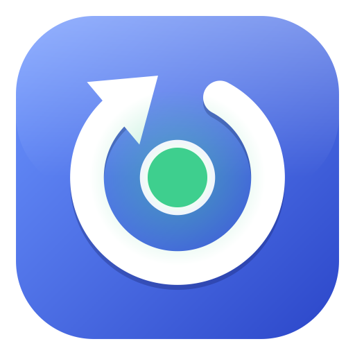

<p align="center">
  
</p>

<h1 align="center">RL Studio</h1>

<p align="center">
  <b>Créer, partager et entraîner des projets d'apprentissage par renforcement — en Python ou sur un modèle Simulink.</b>
</p>

<p align="center">
  
  
  
  
  <br>
  
  
  
  
  
</p>

## Fonctionnalités

- **Gestion de projets** : créer, dupliquer, renommer, supprimer (corbeille récupérable), un dossier par projet.
- **Deux types d'environnements** : Python (`gymnasium.Env`) ou modèle Simulink décrit sans code (signaux, paramètres, récompense).
- **Conversion d'un modèle Simulink existant** : le bouton *Convertir un modèle Simulink…* (barre latérale) analyse un `.slx`, propose entrées → actions et sorties → observations, puis crée un projet avec une **copie** adaptée du modèle (l'original n'est jamais modifié) et la teste à vide.
- **Partage** : export/import de projets en un seul fichier **`.rls`** (double-clic ou glisser-déposer).
- **Entraînement** en direct (récompense, observation, actions) avec comparaison à une politique de référence.
- **Modèle mathématique** : extraction de la politique apprise sous forme de PID, table de gains, arbre de décision ou équation, validée en boucle fermée, exportable en Python / MATLAB / Simulink ([détails](docs/distillation.md)).
- **Installateur Windows** qui détecte le matériel (GPU NVIDIA, MATLAB) et installe les composants adaptés.
- **Thèmes** Sombre, Clair, Matrix et personnalisables ; tous les réglages généraux dans la fenêtre *Paramètres*.

```
projects/<projet>/        un dossier par projet : project.yaml, env.py / model.slx, runs/
templates/                modèles de départ : python_blank, cartpole, simulink_blank, cartpole_simulink
matlab/                   rlstudio_step.m (simulation pas à pas), rlstudio_inspect.m (explorateur)
src/rlstudio/             project.py, archive.py (.rls), envs/, training.py, worker.py, components.py, hardware.py, gui/
packaging/                PyInstaller + Inno Setup : voir packaging/README.md
```

## Application installée (Windows)

Installateur `RLStudio-Setup-x.y.z.exe` : il détecte le matériel (GPU NVIDIA, MATLAB) et installe les
composants de calcul adaptés (PyTorch CUDA ou CPU, MATLAB Engine de la bonne version). Les réglages
généraux sont dans la fenêtre **Paramètres** (apparence, dossier des projets, MATLAB, GPU, composants).
Il associe aussi les fichiers `.rls` à l'application.
Détails d'architecture et de build : [packaging/README.md](packaging/README.md).

## Développement

```powershell
python -m venv .venv                      # Python 3.12
.venv\Scripts\activate
pip install torch --index-url https://download.pytorch.org/whl/cu128   # ou cu130 selon pilote ; voir Paramètres > Calcul
pip install -e ".[gui,runtime,dev]"
pip install -e ".[matlab]"                # seulement pour les projets Simulink
```

```powershell
rlstudio-gui                                  # interface graphique
rlstudio list | templates | new | train | delete | export | import
python -m rlstudio.launcher --scan            # détection du matériel
python -m rlstudio.launcher --provision --dry-run   # plan d'installation des composants
pytest
```

En développement, l'interpréteur de calcul est celui du `.venv` ; dans l'application installée, c'est le runtime
de `%LOCALAPPDATA%\RLStudio\runtime` (ou un Python choisi dans Paramètres > Composants).

## Deux types de projets

**Python** — `env.py` expose `make_env(**params)` (un `gymnasium.Env`) ; `params` vient de
`env.params` dans `project.yaml`. Optionnel : `baseline_policy(env)` pour tracer une référence
pendant l'entraînement (sinon : politique aléatoire).

**Simulink** — aucun code : on déclare dans la GUI (onglet *Environnement*) ou dans `project.yaml`
- **observations** : n'importe quelle sortie de bloc (`bloc` + `port`), journalisée en mémoire
  (le `.slx` n'est jamais modifié) ;
- **actions** : paramètre de bloc (`Constant/Value`, `Gain/Gain`…) ou variable de workspace,
  avec bornes min/max ;
- **état initial aléatoire** : variables du workspace tirées dans un intervalle à chaque épisode ;
- **récompense** et **arrêt anticipé** : expressions utilisant les noms des observations/actions
  et `t`, `dt`, `step` (ex. `-(temp - 20)**2 - 0.01*u**2`).

Le bouton **Explorer le modèle** ouvre un arbre des blocs (via MATLAB) pour ajouter d'un clic
un signal en observation ou un paramètre en action. L'état du modèle est conservé d'un pas à
l'autre côté MATLAB (état final → état initial), un seul appel `sim` par pas de décision.

**Convertir un modèle existant** — le bouton *Convertir un modèle Simulink…* ouvre une fenêtre en quatre étapes : analyse du modèle (entrées, sorties, constantes, solveur, variables manquantes, blocs d'affichage), choix des actions et des observations, variables initiales aléatoires, puis pas de décision et récompense. La conversion enregistre une copie dans un nouveau projet : les entrées racine deviennent des constantes pilotables (`Rl_<nom>`), les sorties sont résolues vers le bloc qui les alimente, les scopes et affichages sont retirés, les variables du workspace sont embarquées dans le modèle (modèle autonome) et le solveur peut être passé à pas fixe. Un script `.m` ou un `.mat` d'initialisation peut être indiqué pour les modèles qui dépendent de variables définies hors du `.slx` (il est exécuté tel quel dans MATLAB). Un épisode court sur la copie vérifie que tout simule.

Limites : signaux de bus non supportés ; un moteur MATLAB par environnement (pour
paralléliser, un process par env). Simulink crée son dossier de cache `slprj` dans
`%LOCALAPPDATA%\RLStudio\cache\simulink`, jamais dans le dossier du projet.

## Partager un projet : le format `.rls`

Un fichier `.rls` est une archive ZIP (manifeste `rlstudio.json` + dossier `project/`). Dans l'application :
*Actions du projet → Exporter (.rls)…* (avec ou sans résultats d'entraînement), et *Importer un projet (.rls)…*,
glisser-déposer du fichier dans la fenêtre, ou double-clic dans l'Explorateur (association faite par l'installateur).
En ligne de commande : `rlstudio export <projet> fichier.rls [--runs none|last|all]` et `rlstudio import fichier.rls`.

L'export exclut les caches (`__pycache__`, `slprj`, `*.slxc`…) et, par défaut, les entraînements. L'import crée toujours
un **nouveau** projet (jamais d'écrasement).

> **Sécurité** — un projet contient du code (`env.py`, modèle Simulink, scripts) qui s'exécute sur votre machine.
> N'importez que des projets de personnes de confiance : l'application affiche la liste des fichiers de code et demande
> une confirmation. L'import refuse les chemins dangereux (`..`, absolus, liens), les archives piégées (taille,
> compression) et tout exécutable ou script système (`.exe`, `.dll`, `.bat`, `.ps1`…).

## Extraire un modèle mathématique de l'agent

L'onglet **Modèle mathématique** (ou `rlstudio distill <projet>`) transforme la politique apprise en loi de commande
lisible : régulateur linéaire/PID, table de gains, arbre de décision, équation parcimonieuse, ou copie exacte du réseau.
Les modèles sont ajustés sur les décisions de l'agent, corrigés par DAgger, comparés en simulation (score normalisé,
complexité, fidélité) ; le plus simple qui reste dans la tolérance est recommandé. Export Python, MATLAB et contrôleur
Simulink. Voir [docs/distillation.md](docs/distillation.md).

## Remarques

- GPU : les petits MLP de SAC/PPO sont souvent plus rapides sur CPU ; un projet en `device: auto` utilise
  le GPU s'il est disponible et autorisé dans Paramètres.

## Licence et composants tiers

RL Studio est distribué sous **licence MIT** — © 2026 Christophe Barras, voir [LICENSE](LICENSE).

- L'interface utilise **Qt 6 via PySide6 sous LGPL v3**, en liaison dynamique (build PyInstaller en mode « dossier »,
  jamais `--onefile`) : l'utilisateur peut remplacer les bibliothèques Qt. Textes dans [`licenses/`](licenses),
  inventaire complet dans [THIRD_PARTY_NOTICES.md](THIRD_PARTY_NOTICES.md).
- Seuls des modules Qt **LGPL** sont embarqués. Certains modules Qt (Virtual Keyboard, Charts, Data Visualization…)
  ne sont disponibles qu'en GPL v3 / commercial : `packaging/check_bundle.py` (liste blanche) fait échouer le build
  si l'un d'eux apparaît.
- MATLAB, Simulink, PyTorch CUDA et `matlabengine` ne sont **pas redistribués** : ils sont installés à la demande,
  avec la licence de l'utilisateur ou de leur éditeur.
